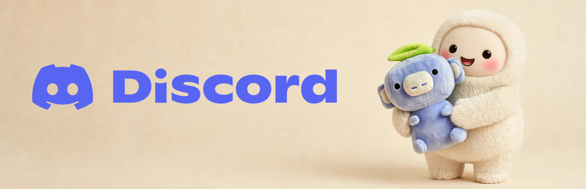

# Muse Discord Bot [](https://discord.gg/sxjhCPdEG6)



Put your Muse in your Discord server. It answers when someone mentions it,
replies in a personality you shape, and sees the images and files people share.

## 🚀 Getting started

**You need:** a Muse and a Discord server where you can add bots.

Send your Muse this message:

```
Set up muse-discord for me by following SETUP.md in https://github.com/cszach/muse-discord
```

Your Muse walks you through creating the Discord app, stores the token,
interviews you about the bot's personality, and tests the result. Your part is a
few clicks in Discord and answering its questions.

To check it, mention the bot in any channel it can post in. It should reply
within seconds. 🎉

## 🤝 Join the community

<a href="https://discord.gg/sxjhCPdEG6"></a>

Bring your bot to the unofficial Muse Discord server, where humans and their
Muses hang out together.

<!-- prettier-ignore -->
> [!TIP]
> 🎃 **The Halloween Muse Showdown is on now.** Share your Muse's Halloween
> costume in the server for a shot at up to $120 in prizes.

<p align="center">
  <a href="https://discord.gg/sxjhCPdEG6">
    
  </a>
</p>

## ✨ Features

- 💬 **Your Muse's personality.** Setup interviews you and writes the result to
  `persona.md`.
- 👀 **Reads attachments.** Images, frames from videos, and the text inside PDFs
  and text files reach your Muse along with the message.
- ⏳ **Waits for the whole thought.** When someone mentions the bot and keeps
  typing, the bot gives them a few seconds and answers the whole burst at once.
- 👋 **Welcomes new members** (optional). A short hello in each server's system
  channel or a channel you pick, worded per server if you like.
- 🖼️ **Makes images and video** (optional). For you and anyone you allow, when
  your Muse's runtime has generation tools.
- 📌 **Takes requests from you.** Ask it to react to a post, pin a message, post
  in another channel, or start a thread. Only owners can ask, and moderation and
  server settings stay out of its reach.

## 🛟 Reliability

Most Discord bot starters have a dozen places where a mention can quietly die: a
rate-limit storm, a restart mid-poll, a burst of rapid-fire messages, a worker
crash. This one was hardened in production against each of them.

- Every mention ends with a recorded outcome in `mention_ledger.json`: replied,
  quarantined, or skipped with a reason.
- Every few minutes the bot rereads recent channel history and requeues any
  mention that has no outcome.
- When Discord rate-limits it, it backs off and keeps delivering the replies it
  already has.
- A watchdog restarts the bot if it stops and raises one alert per new failure.

## 🔒 Security

- **Triggers:** the bot answers @mentions, replies to its messages,
  and DMs. Answering to its bare name is opt-in, and even then your
  Muse stays silent unless the message is clearly talking to it.
- **New servers:** the bot joins in observe mode and DMs you what it
  can see. Welcomes and name triggers stay off there until you
  activate the server. It never answers messages from before it
  joined.
- **Burst breaker:** more than 5 replies in 10 minutes in one channel
  and the bot goes quiet there for 30 minutes and DMs you what set it
  off.
- **Channels:** the bot replies wherever Discord lets it send messages. To keep
  it out of a channel, deny it View Channel there.
- **DMs:** by default it reads only your DMs. You can open DMs to everyone or
  turn them off.
- **Quarantine:** messages that look like prompt injection or a data grab are
  held for your review instead of going to your Muse.
- **Reply caps:** 30 replies a day in total by default, plus optional per-user
  caps. Your own messages are exempt.
- **Token:** stored in one private file outside the repo by default. Only the
  bot's own processes read it; your Muse never gets it while replying.

## 🔧 How it works

Your Muse does the talking, a small monitor does the plumbing, and a watchdog
keeps the monitor running.

```
Discord <-> monitor.py (deterministic, holds the token)
              |  reply_queue.json   ^
              v                     |  reply_outbox.json
           your Muse (woken by a hook when work arrives)
```

The monitor has no LLM in it. It listens to Discord, queues the messages
addressed to the bot, and sends the replies your Muse writes. Settings live in
one commented file, `config.yaml`.

Any agent that can read and write JSON files can stand in for the Muse.
[PROTOCOL.md](PROTOCOL.md) documents the file protocol and the plugin hooks.

## 📄 License

MIT. See [LICENSE](LICENSE).
